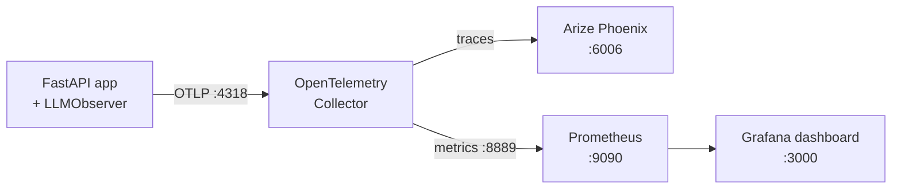

# LLM Observability Kit


Production LLM apps fail in ways normal APIs don't: slow models, runaway token usage, surprise bills and silent upstream timeouts. This kit adds **OpenTelemetry tracing and metrics to any LLM call in three lines**. It also includes a ready-made stack: **Arize Phoenix** for traces, and **Prometheus + Grafana** for token, cost, latency and error dashboards.

```python
from llm_obs import LLMObserver, LLMResult

obs = LLMObserver(service_name="support-bot")          # OTLP endpoint from OTEL_EXPORTER_OTLP_ENDPOINT

with obs.llm_call("demo-small", provider="anthropic", prompt=question) as call:
    resp = client.messages.create(...)                  # any provider
    call.record(LLMResult(resp.content[0].text, resp.usage.input_tokens, resp.usage.output_tokens))
```

## What gets captured

| Signal | Details |
| --- | --- |
| **Span per LLM call** | `gen_ai.request.model`, `gen_ai.system`, `gen_ai.usage.input_tokens/output_tokens` (OTel GenAI conventions) plus OpenInference attributes, so Phoenix shows prompt, response and token counts |
| **Cost** | `llm.cost_usd` on each span, from a configurable price table; unpriced models are flagged rather than silently counted as $0 |
| **Errors** | Exceptions recorded on the span with ERROR status, and counted in `llm.requests{status="error"}` |
| **Request context** | HTTP → retrieval → LLM spans share one trace, so a slow request can be pinned to the step that caused it |
| **Metrics** | `llm.tokens` (by model and token type), `llm.cost_usd`, `llm.requests` (by status) and the `llm.request.duration` histogram |

## Architecture



The Grafana dashboard (`deploy/grafana/dashboards/llm-observability.json`) is provisioned automatically. It shows requests, tokens, estimated cost and error rate as headline numbers, plus p50/p95 latency by model, token throughput, cost per hour by model and requests by status.

## Quick start

```bash
git clone https://github.com/koorasupriya/llm-observability-kit.git
cd llm-observability-kit
pip install -e ".[dev]"

# 1. Start the stack (needs Docker)
docker compose -f deploy/docker-compose.yml up -d

# 2. Run the demo API and send it traffic
export OTEL_EXPORTER_OTLP_ENDPOINT=http://localhost:4318      # Windows: set OTEL_EXPORTER_OTLP_ENDPOINT=...
uvicorn llm_obs.demo_app:app --port 8000 &
python -m llm_obs.loadgen --requests 200
```

Then open Phoenix at http://localhost:6006 for traces and Grafana at http://localhost:3000 (admin / admin) for the **LLM / LLM Observability** dashboard.

The demo uses a `FakeLLM` with realistic latency, token counts and a 5% timeout rate, so it needs no API key. Swap in a real client inside `observer.llm_call(...)` when you're ready.

## Pricing

Cost is estimated from `src/llm_obs/pricing.py`. The built-in prices are **illustrative demo values**. For real numbers, put your provider's current prices (USD per 1M tokens) in a JSON file:

```json
{ "your-model-name": { "input": 3.0, "output": 15.0 } }
```

```bash
export LLM_PRICING_FILE=pricing.json
```

## Tests

```bash
pytest
```

Tests use OpenTelemetry's in-memory exporters to check span attributes, token, cost and latency metrics, error recording, flagging of unpriced models, trace parenting, and the demo API's HTTP → retrieval → LLM trace.

## License

MIT
